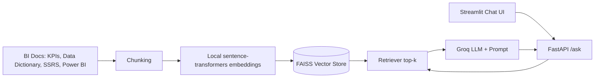

# 📊 Enterprise BI Knowledge Assistant (RAG)

A Retrieval-Augmented Generation chatbot that answers questions about KPI definitions, data dictionary
tables, SSRS reports and Power BI dashboards, with source citations.


## Architecture


## Tech Stack
Python, LangChain, Hugging Face sentence-transformers (all-MiniLM-L6-v2), Groq API, FAISS, FastAPI,
Streamlit, Docker, rank-bm25, pytest

## Dataset
186 synthetic documents generated by `scripts/generate_data.py`: 150 KPI definitions, 16 data-dictionary
tables, 10 SSRS report docs and 10 Power BI dashboard docs. 50 evaluation questions are in
`data/eval/questions.json`.

## Quick Start
```bash
git clone https://github.com/<your-username>/bi-knowledge-assistant.git
cd bi-knowledge-assistant
cp .env.example .env        # then add your Groq API key
docker compose up --build
```
- Chat UI: http://localhost:8501
- API docs: http://localhost:8000/docs

To rebuild the index: `python -m src.ingest`

## Evaluation
50 test questions. Metrics: retrieval hit rate@k and answer relevance (1-5, LLM-as-judge against a
reference answer). A BM25 keyword search is the baseline.

| name | chunk | overlap | k | prompt | hit_rate | avg_score | improvement % |
|---|---|---|---|---|---|---|---|
| bm25_baseline | 800 | 100 | 4 | v1 | 0.80 | 4.20 | 0.0 |
| rag_v1 | 1000 | 0 | 3 | v1 | 0.90 | 4.52 | 7.6 |
| rag_v2 | 800 | 100 | 4 | v1 | 0.92 | 4.58 | 9.0 |
| rag_v3 | 500 | 100 | 5 | v1 | 0.90 | 4.60 | 9.5 |
| rag_v4 | 500 | 100 | 5 | v2 | 0.90 | 4.56 | 8.6 |
| rag_v5 | 800 | 100 | 4 | v2 | 0.92 | 4.58 | 9.0 |

**Best configuration (rag_v3):** chunk_size=500, overlap=100, top-k=5, prompt v1.
**Result:** answer relevance improved 9.5% over the keyword baseline (4.20 to 4.60), and hit rate rose
from 80% to 90%. The engineered prompt (v2) did not beat the simple prompt, so the simple one was kept.

## Latency
Measured over 50 requests through the FastAPI endpoint: average <X.XX>s, median <X.XX>s, p95 <X.XX>s.

## Example
**Q:** How is customer churn rate calculated?
**A:** <paste a real answer from your app>
**Sources:** customer_churn_rate.md

## Limitations & Future Work
- Data is synthetic, and the LLM-judge scores are approximate; add human review
- Score differences between configurations are small on 50 questions
- Add a reranker and hybrid (BM25 + vector) search
- Add authentication, caching and conversation memory
